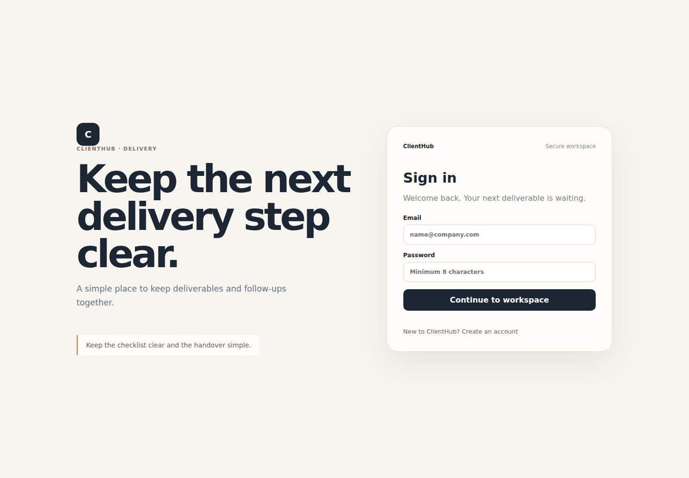
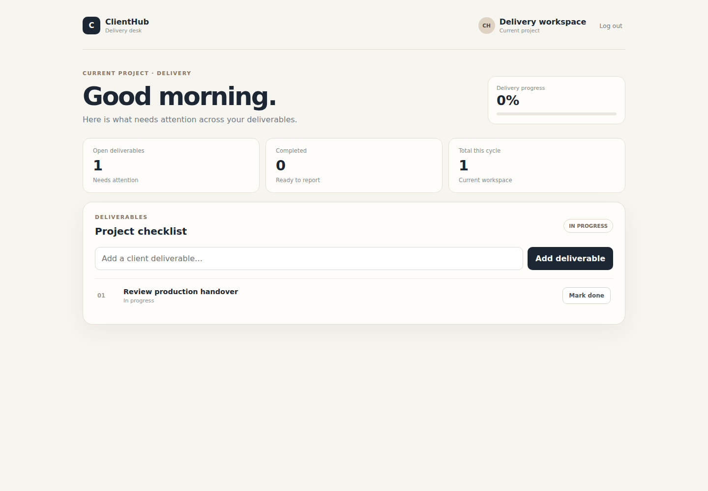
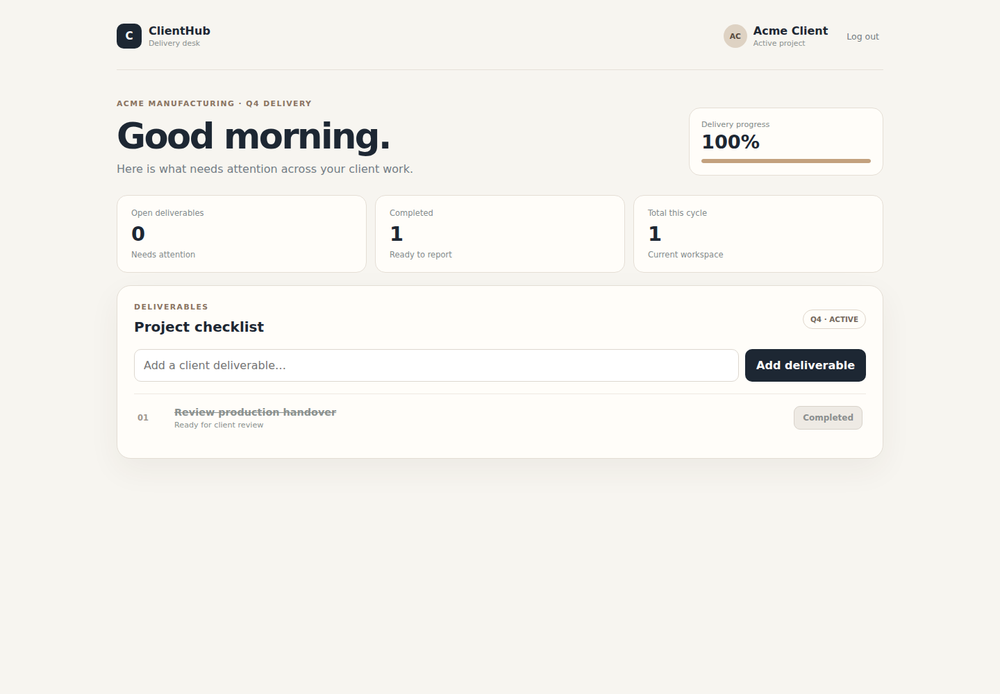

# ClientHub


ClientHub is a React 18 + TypeScript interface for reviewing a list of work deliverables. Users can add an item, search by title, filter the list by status, and see how many items are complete. It uses the shared [TaskForge API](https://github.com/imenabidimen/taskforge-api) for sign-in and persistence.

[WorkBoard](https://github.com/imenabidimen/workboard-vue) uses the same API from Vue, but keeps its interface to the everyday task cycle: add a task and mark it complete. ClientHub puts more emphasis on finding and reviewing items in a list. Neither frontend has its own copy of the backend data.

## Stack

- React 18 and TypeScript
- Vite
- Vitest and Testing Library
- TaskForge API (NestJS, PostgreSQL)

## What you can do

- Create an account and sign in
- Open the authenticated workspace
- Add and complete deliverables
- Search by title and filter to open or completed items
- Review completion percentage and open/completed counts
- See loading, empty and API-error states
- Handle an expired session
- Send authenticated requests with a bearer token

## Run locally

Start [TaskForge API](https://github.com/imenabidimen/taskforge-api) first, with its API available at `http://localhost:3000/api`. Then:

```bash
npm ci
npm run dev
```

If the API uses a different address, copy `.env.example` to `.env.local` and set `VITE_API_URL` to the API base URL (include `/api`). Vite reads `.env.local` when starting the dev server.

```bash
npm test
npm run build
```

## Screenshots

These browser captures come from the CI workflow using a fresh test account against TaskForge and PostgreSQL.

### Sign in


### Create an account


### Add a deliverable


### Complete a deliverable


## Scope

The interface calls its items “deliverables”, but the API currently stores them using the shared task model. There are no separate client, project or deliverable tables. Search, status filtering and the progress summary are frontend features over that task data; this is a focused UI comparison, not a claim that the repository is a complete CRM.
